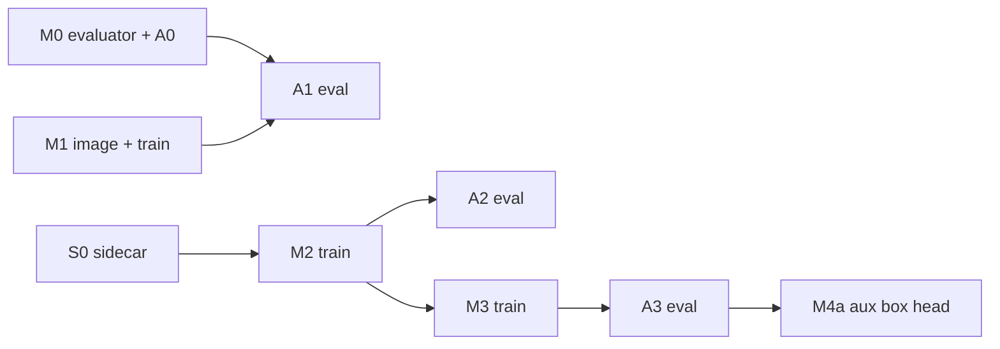

# VLA inputs programme — same data, new information — design

**Date:** 2026-10-30. **Status: draft for external review.** Direction, sub-projects and order approved by the user on
2026-10-30; everything below the "Approved" table is proposed and open to review. Nothing has been built or run except
the read-only checks cited here. Follows P3, closed as a failed attempt
([PROPS_P3_EVALUATION_20261027.md](../../PROPS_P3_EVALUATION_20261027.md)).

## Question

Every phase so far changed the **dataset**. This programme holds the data fixed and changes **what the model sees** (and,
later, what it emits). With the 540 sealed P2 episodes unchanged:

1. Does a different VLA family (pi0.5) do better than X-VLA on the same data and inputs? (M1)
2. Does contact information in the robot state (wrist force/torque, finger contact forces) improve success? (M2)
3. Does the target's 2D bounding box in the robot state improve success? (M3)
4. Can the box be learned as an auxiliary output, so it is not needed at test time? (M4a). Later: action outputs that carry
   force (M4b, scoped only).

## Approved 2026-10-30 (user)

| item | decision |
|---|---|
| sub-projects | M0 evaluation protocol and baseline, S0 extra-signal sidecar, M1 pi0.5 vs X-VLA, M2 force/torque in state, M3 bounding box in state, M4 output side |
| order | M0 and S0 (CPU) in parallel with M1 training (GPU); then M2, then M3, then M4a |
| pi variant | pi0.5 (`pi05` in the pinned LeRobot 0.4.4), base weights `pi05_base` |
| pi recipe | each model's own recipe at matched exposure (epochs), stated as "model plus its recipe" |
| F/T signals | wrist 6-axis force/torque + 2 finger contact forces, per frame at 30 Hz, per-dimension normalisation, no history |
| box form | numbers in the state, target object only, both cameras, normalised to [0, 1]; drawn-on-image later as a variant |
| framing | M2 and M3 are information upper bounds (privileged simulator signals at test time), not deployable gains |
| evaluation | fresh reserved layouts disjoint from every P2 layout, size from a power analysis, every arm on the same layouts, McNemar, per-object tables, pre-registered criteria per sub-project |
| where | specs and plans committed on `main` for review first (user, 2026-10-30); work happens later on `feat/vla-inputs` in a worktree |

## Why this is possible without new data

The P2 root keeps, per episode, the full simulator trace: `episodes/episode_NNN.npz` holds `qpos` (every joint and every
free body, float64), `ctrl`, `props_pose` for each of the 452 frames, and the `initial_state`. **Measured 2026-10-30:**
replaying the sealed actions from the sealed initial state reproduces the sealed `qpos` byte for byte (3 of 3 episodes probed,
every frame, error 0.0). So every extra quantity can be recorded at the exact instant of each recorded frame, with the replay
proven equal to the sealed trace for all 540 episodes before anything is read from it (S0). The images and the actions the
model is trained on stay the sealed ones.

## Sub-projects

| id | spec | needs | GPU | output |
|---|---|---|---|---|
| M0 | [m0 common evaluation](2026-10-30-vla-inputs-m0-evaluation-design.md) | P2 bundle | eval only | a policy-agnostic evaluator, two reserved tiers, the control arm A0 measured |
| S0 | [s0 signal sidecar](2026-10-30-vla-inputs-s0-signals-design.md) | P2 seal | none | sealed per-frame F/T, finger forces, boxes for all 540 episodes; the same signal code for rollouts |
| M1 | [m1 pi0.5 on P2](2026-10-30-vla-inputs-m1-pi05-design.md) | M0 (for evaluation) | training | arm A1 |
| M2 | [m2 force/torque in state](2026-10-30-vla-inputs-m2-force-design.md) | S0, M0 | training | arm A2 |
| M3 | [m3 box in state](2026-10-30-vla-inputs-m3-box-design.md) | S0, M0, M2's package | training | arm A3 |
| M4 | [m4 output side](2026-10-30-vla-inputs-m4-outputs-design.md) | M3 result | training | arm A4 (M4a); M4b scoped only |

Plans: [M0](../plans/2026-10-30-vla-inputs-m0-evaluation.md) · [S0](../plans/2026-10-30-vla-inputs-s0-signals.md) ·
[M1](../plans/2026-10-30-vla-inputs-m1-pi05.md) · [M2](../plans/2026-10-30-vla-inputs-m2-force.md) ·
[M3](../plans/2026-10-30-vla-inputs-m3-box.md) · [M4](../plans/2026-10-30-vla-inputs-m4-outputs.md).

## Arms (all evaluated by M0 on the same layouts)

| arm | model | state | images | data | trained by |
|---|---|---|---|---|---|
| A0 | X-VLA, P2 checkpoint 101,520 (bundle) | 9 | sealed P2 | P2 | existing (2026-10-16) |
| A1 | pi0.5 | 9 | sealed P2 | P2 | M1 |
| A2 | X-VLA | 9 + 8 (F/T 6, finger forces 2) = 17 | sealed P2 | P2 + S0 | M2 |
| A3 | X-VLA | 9 + 10 (box 4 + visible 1, per camera) = 19 | sealed P2 | P2 + S0 | M3 |
| A4 | X-VLA + auxiliary box head | 9 | sealed P2 | P2 + S0 (targets only) | M4a |

A2, A3 and A4 use P2's recipe unchanged (126,900 updates = 5.0 epochs, effective batch 8, the same checkpoint grid and the
same sample order). X-VLA has 20 proprioception slots (`check_model_inputs` pads 9 to 20 with zeros), so 17 and 19 fit
without an architecture change.

## Rules that hold in every sub-project

- **One variable per arm.** A1 changes the model (and its recipe), A2 only the state contents, A3 only the state contents, A4
  only the training loss. Renderer stays OSMesa (EGL is not adopted; A0 must not be evaluated under EGL).
- **Nothing sealed is edited.** P2's `provenance()` hashes 76 files (`experiments/props_p2_data/**`, `experiments/props_scene/*.py`,
  `experiments/robosuite_scene/*.py`, `src/**`, the P2 spec and plan, shared helpers). They are imported read-only; where
  behaviour must differ the code is forked into the new package, never patched on disk.
- **Every new training package proves equality before it trains:** with its extra inputs set to zero it reproduces P2's
  training byte for byte over 30 updates (M2, M3, M4a). That makes the extra inputs the only difference in the real run.
- **Selection never touches the comparison tier.** Checkpoints are chosen on M0's selection tier; the comparison tier is run
  once per arm with one checkpoint.
- **Offline metrics are never used** to choose, stop, or claim.
- **Predictions are written before rollouts** (each spec has one) and results are reported against them, including nulls.
- Docs pass on every finding; commits by the user only; nothing pushed by the agent.

## Predictions (written 2026-10-30, before any run)

- P2's failures at 101,520 are dominated by "never lifted" (12 of the 30 report failures; all 12 closed the gripper, 9 held the
  target), with milk the weakest object (57.6% on 118 fresh trained-bin layouts). Wrong object is 7 of 120.
- **M3 (box):** wrong-object choices should fall toward zero (the target box says which object); little effect on milk's hold.
  Expected overall gain at most about the wrong-object rate (≈ 6 points), which M0 can detect only with low power.
- **M2 (F/T):** the only arm with a mechanism aimed at the hold. But the state already contains both finger positions, so the
  policy already "knows" the gripper closed; the new information is load (object weight 0.5–2 N at the wrist, masses
  0.05–0.20 kg) and grip force. The expert never fails a grasp, so demonstrations contain no recovery. **A null is plausible.**
- **M1 (pi0.5):** no confident prediction; larger VLM, different action head, state given as text tokens.

## What this programme cannot show

- That a deployable robot benefits: the extra signals are exact simulator quantities (an upper bound). F/T has a real-robot
  analogue (estimated external wrench); the box needs a detector or M4a.
- Anything about other tasks, objects, or more data. The data is P2's, unchanged.
- That pi0.5 is a better *model* in general: A1 is pi0.5 with its recipe on 540 episodes, against X-VLA with P2's recipe.

## Known blockers and costs (measured or read, 2026-10-30)

| item | finding | where it lands |
|---|---|---|
| pi0.5 cannot be constructed in the pinned image | `PI05Pytorch.__init__` requires `transformers.models.siglip.check` (LeRobot's patched transformers); the image has transformers 4.57.6 and the import fails | M1 Task 1: a new image, its own digest |
| pi0.5 base weights and the PaliGemma tokenizer are not in the image | `google/paligemma-3b-pt-224` is a gated Hugging Face repo (licence acceptance, token); containers run offline | M1 Task 1: fetched on the host through the proxy, hash-pinned, token never committed |
| disk | 123 GB free (2026-10-30), `/var/log/syslog` grows ~30 GB/day and the user is not in sudoers | every training plan has a disk gate; pi0.5's working set is larger than X-VLA's (M1) |
| GPU | shared; another user's job held 37 of 48 GiB on 2026-10-23 | the runners' free-memory guards stay; not relaxed |
| X-VLA training time | 0.524 s/update raw, ~0.9 effective with thermal pauses → about 32 h per X-VLA arm | M2, M3, M4a |
