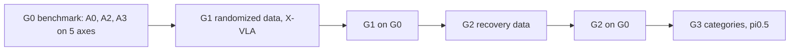

# Generalization programme (G) — five capabilities, measured — design

**Date:** 2026-11-06. **Status: approved by the user 2026-11-06** (direction, order, model, task; decisions table below). Follows the
VLA inputs programme ([spec](2026-10-30-vla-inputs-programme-design.md)), whose arms A0–A3 are the starting policies. Inspired by
GraspVLA ([paper](https://arxiv.org/abs/2505.03233), [project](https://pku-epic.github.io/GraspVLA-web/),
[SynGrasp-1B](https://huggingface.co/datasets/vegebirrd/SynGrasp-1B)). Nothing is built.

## Goal

Give our Franka bin-sorting policy, and **measure** in simulation, the generalization GraspVLA demonstrates for grasping:

| # | capability | what it means here | priority |
|---|---|---|---|
| 1 | distractors | more distractors than trained (3–5), including object types never seen | core |
| 2 | lighting | intensity, colour, direction and shadow conditions never seen | core |
| 3 | background | table and floor/wall appearances never seen | core |
| 4 | spatial | table height, object start region and bin positions outside the trained ones | core |
| 5 | closed-loop | the target is moved, or the grasp is lost, during the episode; the policy must recover | core |
| 6 | categories | objects never trained on | **last, not strict** (user, 2026-11-06) |

The task stays **instruction-driven bin sorting** (P2's): `put the <object> in the <colour> bin`, success = the target resting in the named
bin. **Grasp-and-lift success** (the target lifted at least 5 cm at any tick) is reported as a sub-metric for every trial, as the number
comparable in kind to GraspVLA's (user, 2026-11-06). No claim compares our numbers with GraspVLA's: different robot set-up, task, simulator
and renderer.

## What GraspVLA teaches, and what it does not transfer

| fact (paper v3 and appendices) | consequence here |
|---|---|
| Capabilities 1–5 come from **training-data diversity**: randomized lighting (point, directional, dome), ~1,000 table and ~1,200 floor/wall textures, camera pose (15 cm ball, ±5°), table height (−0.1 to +0.2 m), layouts and initial robot pose, over 10 M trajectories | the lever is the **data**, not the architecture; X-VLA can learn the same invariances from randomized data |
| Its expert is open-loop (planned grasp, then lift); closed-loop correction **emerges** from chunked replanning plus state diversity, there are no recovery demonstrations | closed-loop is first **measured** (G0); recovery data (G2) is the targeted fix if G0/G1 show it is missing |
| Category generalization needs 240 training categories **and** co-training with web grounding data through box-token chain of thought (PAG); single view costs ~30 points | categories need a web-grounded model and many objects; X-VLA's checkpoint has no Florence-2 decoder (checked 2026-11-05), so it is the last phase, with pi0.5 |
| It is evaluated per axis: basic, lighting, background, distractors (5 objects), height (+10 cm), 15 objects × 2 trials each, plus disturbance videos | G0 evaluates per axis, each perturbed trial paired with the same layout under nominal conditions |

## What we already know (our evidence)

| fact | source |
|---|---|
| A visual domain shift alone collapsed a policy: the B2 checkpoint scored 3/20 in the robosuite scene against 19/20 in its own | [ROBOSUITE_SIM2SIM_20261002.md](../../ROBOSUITE_SIM2SIM_20261002.md) |
| Objects held out of training scored 5.7% (P3) | [PROPS_P3_EVALUATION_20261027.md](../../PROPS_P3_EVALUATION_20261027.md) |
| On M0's 573 layouts: A0 78.7%, A2 (force) 91.3%, A3 (force + oracle box) 99.65% | [RESULTS.md](../../RESULTS.md) |
| M3b night A (raw counts from `result.json`, analysis pending): A3 fed a box jittered by 6 px scored 542/573, by 18 px 345/573 (below A2's 523), with the gripper box missing half the time 545/573, and with a distractor's box **0/573** (446 never lifted, 126 wrong object) | `outputs/vla_inputs_eval/m0_20261030/arms/A6..A9`; to be reported by the M3b closing step |
| The props expert is phase-scripted; each phase's target is derived from the state when the phase starts (the close phase re-reads the object), so it re-targets at phase boundaries but never recovers a lost grasp | `experiments/props_scene/expert.py` |
| P2's training data has one fixed lighting, one table/floor appearance, one table height, 1–2 distractors from the same six props, home jitter ≤ 1° | `experiments/props_scene/constants.py`, P2 plan |

Consequence for the inputs: **the oracle box is dropped.** A3 follows whatever box it is given (A9), so a box input is a liability
outside the oracle. Generalization arms use **A2's inputs** (9 joints + 8 force/torque values, two cameras, the instruction).

## Decisions (approved 2026-11-06)

| id | decision |
|---|---|
| P1 | **Stop M3b** now (detector training and A5 not run); record night A (A6–A9) as M3b's partial result. The question it leaves open (a predicted box) does not feed any G decision, because G drops the box |
| P2 | Task: bin sorting, grasp-and-lift as a sub-metric. No alternative task for now |
| P3 | Inputs: A2's. No oracle box |
| P4 | Model: X-VLA for G0–G2. No GraspVLA for now. pi0.5 for G3 (M1 folded into G3) |
| P5 | G0 axes and levels as in the G0 spec, fixed before any run |
| P6 | G1 scale: about 3,000 episodes, trained at M2's update budget (126,900 updates, about 28–30 h) |
| P7 | Assets: CC0 textures (ambientCG, Poly Haven) downloaded on the host, hash-pinned; CC-BY object meshes only when G3 starts |
| P8 | M4a paused; M1 folded into G3 |
| P9 | **Order: G0 → G1 → G2 → G3** |

## Sub-projects

| id | question | builds | needs GPU for | spec / plan |
|---|---|---|---|---|
| **G0** | Which capabilities do our policies lack, and by how much? | a new frozen evaluator with five perturbation axes, paired with nominal; the shared randomization engine (test pools) | evaluation only: A0, A2 (and A3 descriptive) | [spec](2026-11-06-g0-generalization-benchmark-design.md) · [plan](../plans/2026-11-06-g0-generalization-benchmark.md) |
| **G1** | Does a domain-randomized dataset give X-VLA capabilities 1–4 (and help 5)? | randomized collection (training pools, disjoint from G0's test pools where identity matters), X-VLA training with A2's inputs | collection is CPU; training ~30 h; G0 evaluation | [spec](2026-11-06-g1-randomized-data-design.md) · [plan](../plans/2026-11-06-g1-randomized-data.md) |
| **G2** | Do recovery demonstrations (disturbance during collection, the expert re-targets or re-grasps) give closed-loop recovery beyond G1? | a recovering expert, disturbance injection, a G1-style dataset plus recovery episodes | training ~30 h; G0 evaluation | own spec after G1's G0 result |
| **G3** | Can a web-grounded model (pi0.5) generalize to object categories never trained on? | many CC-BY meshes, a grasp expert for arbitrary meshes, pi0.5 training (expert-only, VLM frozen; images and contract exist from M1) | training; G0 evaluation with a categories axis | own spec last; not strict |

**Parallelism (do not waste time):** G0's evaluator and G1's collector share one new package, the **randomization engine**
(`experiments/gen_scene/`), with separate train and test pools. G1's collector is built on the CPU while G0's GPU nights run.

## Rules for the whole programme

- **Test conditions are fixed before any policy is run on them, and are never tuned on results.** Texture identities and distractor object
  types used at test time are **disjoint** from the training pools (true novelty); continuous factors (light intensity, direction, colour,
  table height) are tested at fixed levels, and each spec states whether a level lies inside or outside the training range.
- **Every axis is measured paired:** the same layout under nominal and under the perturbation, one trial each; layout is the unit.
- **One variable per arm:** G1 against A2 changes the training data (a deliberate bundle of randomizations; per-factor attribution comes from
  G0's per-axis read-out, not from ablations). G2 against G1 adds recovery episodes only.
- Predictions are written before runs, with a range per failure class and per axis (FAILURES #69).
- Offline metrics never choose, stop or claim. Checkpoints are chosen on a selection tier, never on the G0 benchmark tier.
- Nothing sealed or frozen is edited: `props_scene`, `robosuite_scene`, P2's data and package, S0, M0's core, M2/M3 packages are imported
  read-only; changed behaviour is forked into the new packages.
- Renderer stays OSMesa (as every sealed run and M0). Lighting is MuJoCo's rasterized lights, not ray tracing; claims are about this renderer.
- Docs pass on every finding; commits by the user's identity, `--no-ff` merges, nothing pushed.

## Compute and disk (measured 2026-11-06)

One RTX 6000 Ada 48 GB shared with others; 48 cores; 138 GB free on `/`. X-VLA trains at ~0.52 s/update raw, ~28–30 h per 126,900 updates
with thermal pauses. M0-style rollouts: ~2.7 h per 573 trials with 6 workers. P2's collection: 540 episodes in 54 min with 12 shards.

## What the programme cannot show

- Anything about a real robot or a real camera: simulation only, rasterized rendering.
- That the randomized policy is better than GraspVLA, or comparable to it in numbers.
- Which randomized factor produced which capability (no per-factor ablations planned).
